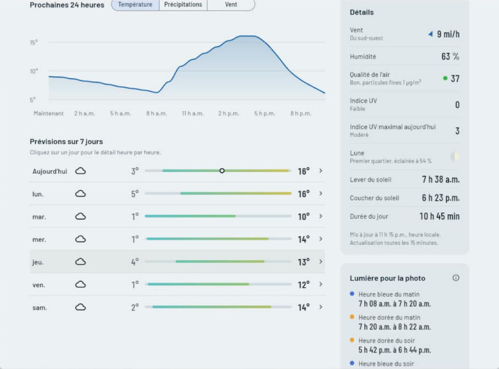
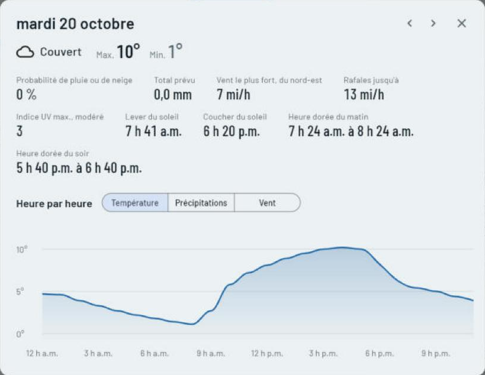
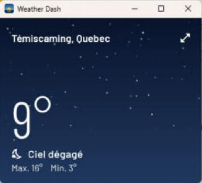

# Weather Dash

A weather dashboard for Windows and the web, built with Flutter for Monthly Build Challenge #1.

The top of the window is a sky that changes with the real weather: bright blue on a clear afternoon, grey and drifting under cloud, rain or snow falling when it's wet, and stars over a deep navy on a clear night. Along its bottom edge, the horizon traces the sun's path from sunrise to sunset and shows where the sun is right now, with the moon's phase beside it after dark.


| French, light mode | A day's details | Mini mode |
|---|---|---|
|  |  |  |

This was my entry for the local developers' group Monthly Build Challenge #1. The approach and what I learned are in [SUBMISSION.md](SUBMISSION.md).

## Try it in your browser

The web version runs at **https://petenid.github.io/weather_dash/**, no installing needed. It has everything except the desktop-only extras (mini mode and saving pictures to a folder).

## Download

Go to the [latest release](https://github.com/Petenid/weather_dash/releases/latest) and pick one:

- **WeatherDash-…-windows-setup.exe** installs Weather Dash with a Start menu shortcut. No administrator password needed.
- **WeatherDash-…-windows-portable.zip** runs without installing. Unzip it anywhere and open `weather_dash.exe`.

Requires 64-bit Windows 10 or 11. The app isn't code-signed, so Windows SmartScreen may warn the first time. Choose **More info**, then **Run anyway**.

## What it shows

- Current conditions: temperature, feels-like, wind, humidity, UV index and air quality, plus Environment Canada's wind chill and humidex with their health-risk levels
- The next 24 hours as a chart you can switch between temperature, chance of rain or snow, and wind
- A 7-day forecast, with each day's low-to-high range drawn on a shared scale and coloured by temperature. Click a day for its hour-by-hour details
- Three national forecast models (Canada's GEM, the US GFS and Europe's ECMWF) compared side by side, with a plain-language note on where they disagree
- "At a glance" notes: how today compares with the 30-year normal, the best two hours to be outside, frost warnings, and the chance of seeing the northern lights tonight
- Official Environment Canada weather alerts for Canadian locations
- A radar map of rain and snow over the last two hours
- Sunrise, sunset, hours of daylight and the moon's phase
- Golden hour and blue hour for photographers, worked out from the sun's position
- City search for anywhere in the world, your current location, and saved places one click away
- Mini mode: a small window that stays on top of your other windows
- Copy or save a picture of the current weather to share
- Works offline with the last forecast it downloaded, and tells you when a new version is out
- English and Quebec French, following your system or chosen in settings, with French place names and Environment Canada alerts in French
- Settings for 12- or 24-hour time, wind units, and light or dark appearance
- Power saver: stops the animation and refreshes hourly. The sky also rests while Weather Dash is in the background
- Refreshes itself every 15 minutes

Keyboard shortcuts: **Ctrl+F** finds a city, **Ctrl+D** saves or removes the place on screen, **Ctrl+M** switches mini mode, **F5** or **Ctrl+R** refreshes.

## Data and credits

- Weather data by [Open-Meteo.com](https://open-meteo.com/), under [CC BY 4.0](https://creativecommons.org/licenses/by/4.0/)
- Forecast models: Environment and Climate Change Canada (GEM), NOAA (GFS) and ECMWF (IFS), through Open-Meteo
- Air quality: [Copernicus Atmosphere Monitoring Service](https://atmosphere.copernicus.eu/) (CAMS), through Open-Meteo's air quality API
- Past weather for the 30-year normals: ERA5 from the [Copernicus Climate Change Service](https://climate.copernicus.eu/), through Open-Meteo's historical weather API
- Weather alerts: [Environment and Climate Change Canada](https://weather.gc.ca/) (MSC GeoMet)
- Aurora forecast: [NOAA Space Weather Prediction Center](https://www.swpc.noaa.gov/)
- Radar: [RainViewer](https://www.rainviewer.com/) (free for personal and educational use)
- Maps: © [OpenStreetMap](https://www.openstreetmap.org/copyright) contributors
- Place names for "Use my location": [Nominatim](https://nominatim.org/), OpenStreetMap
- Place search by [GeoNames](https://www.geonames.org/), through Open-Meteo's geocoding API
- Typeface: [Barlow](https://github.com/jpt/barlow) by The Barlow Project Authors, under the SIL Open Font License (see `assets/fonts/OFL.txt`)

None of these services needs an API key for personal use, so this repository contains no keys or secrets.

## Build it yourself

1. Install [Flutter](https://docs.flutter.dev/get-started/install/windows/desktop) and Visual Studio with the "Desktop development with C++" workload.
2. Clone this repository, then run:

   ```
   flutter pub get
   flutter run -d windows
   ```

3. For a release build: `flutter build windows --release`. The app ends up in `build\windows\x64\runner\Release`.

## Tests

`flutter test` runs two sets of checks:

- `test/widget_test.dart` checks the calculations: wind chill and humidex against Environment Canada's tables, the moon's phase, the sun's position, unit conversions, and French formatting.
- `test/screens_test.dart` builds every screen in English and French, at desktop and phone sizes, from a saved sample forecast (`test/fixtures`). Any text that doesn't fit makes the test fail.

GitHub runs both on every push.

## How releases are made

GitHub Actions (`.github/workflows/build.yml`) checks the code, runs the tests and builds the app on every push to `main`. Pushing a version tag publishes a release with the installer and the zip:

```
git tag v1.0.0
git push origin v1.0.0
```

The installer is made with [Inno Setup](https://jrsoftware.org/isinfo.php) from `installer/weather_dash.iss`.
