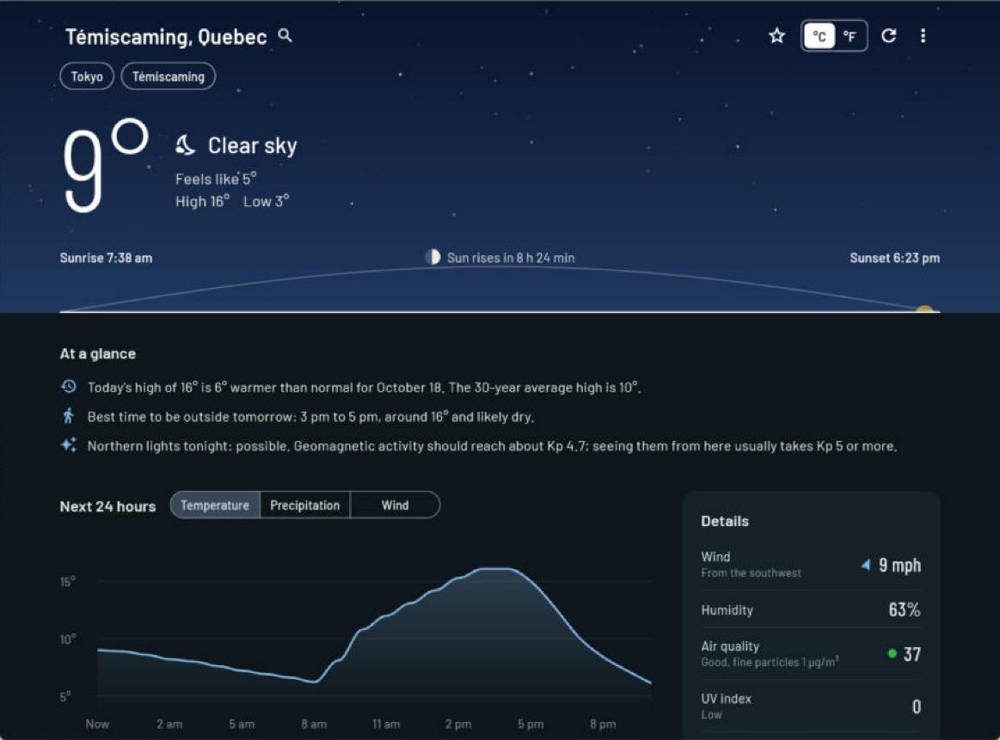

# Monthly Build Challenge #1: Weather Dash

**Try it:** [in your browser](https://petenid.github.io/weather_dash/) · [download for Windows](https://github.com/Petenid/weather_dash/releases/latest) · [source code](https://github.com/Petenid/weather_dash)

Weather Dash is a weather dashboard built with **Flutter**, running as a Windows app and in the browser from the same code. The top of the window is a sky that follows the real weather (rain falls, snow drifts, stars come out on clear nights), and its horizon traces the sun's path from sunrise to sunset.

## What it does

- Current conditions, the next 24 hours (temperature, precipitation or wind) and a 7-day forecast. Click any day for its hour-by-hour details.
- Three national forecast models, Canada's GEM, the US GFS and Europe's ECMWF, compared side by side, with a plain-language note on where they disagree.
- "At a glance" notes: today against the 30-year normal, the best two hours to be outside, frost warnings, and the chance of seeing the northern lights.
- Environment Canada alerts, wind chill and humidex, air quality, UV, moon phase, a radar map, and golden and blue hour for photographers.
- English and Quebec French, light and dark, °C or °F, saved places, a mini always-on-top window, offline mode, and an installer with update notices.

## The approach

| | |
|---|---|
| Language and framework | Dart and Flutter, one codebase for Windows and the web (a phone version is next) |
| Data | Open-Meteo for weather, models, history and air quality; Environment Canada for alerts; NOAA for the aurora; RainViewer and OpenStreetMap for radar. All free, all keyless |
| Secrets | None needed. Every service works without an API key, so there's nothing to leak |
| Packaging | GitHub Actions tests and builds every push, publishes the website, and turns a version tag into a release with an installer (Inno Setup) and a portable zip |
| How it was built | My first time pair programming with Claude, an AI assistant. Claude wrote most of the code and explained each step; I installed the tools, ran and tested everything, made the decisions, and reported what broke |

Credits: weather data by [Open-Meteo.com](https://open-meteo.com/). Full credits are in the [README](README.md#data-and-credits).

## What I learned

**Weather apps don't agree, and that's normal.** On day one my app said 2.5° when Apple Weather said 4°. Forecasts are computer-model estimates for a grid square, not thermometer readings, and every app uses different models. That's why I added the model comparison: you can see Canada's, the US's and Europe's models disagree by several degrees later in the week.

**Real services fail, and free services change.** Open-Meteo once timed out and sent back an error message instead of data, which crashed my first version. Halfway through, the map provider I was using started requiring an API key, and the radar service had cut back its free tier earlier in the year. So the app keeps showing the last good data, saves a copy for offline use, explains errors in plain words, and I checked each service's terms before using it.

**Translation is more than words.** Quebec French writes times as "13 h 05", uses a decimal comma and a space before "%", and has its own weather vocabulary (bruine, pluie verglaçante, averses). Longer French words also broke layouts: "Aujourd'hui" didn't fit where "Today" did.

**Tests are a second pair of eyes.** I couldn't check every screen in two languages and two sizes by hand, but automated tests could. They caught the French layout problem before anyone saw it, and GitHub runs them on every push.

**Canadian weather has its own rules.** Environment Canada only reports wind chill at 0 °C or colder, and humidex has its own discomfort scale. Using their formulas and wording made the numbers match what people here expect.

**The basics matter too.** It was my first Flutter project and my first time pair programming with an AI. I learned to set up PATH and Visual Studio's C++ tools, to use Git and GitHub, and, the hard way, to turn on Auto Save in VS Code: my code "didn't work" twice because the file wasn't saved.
